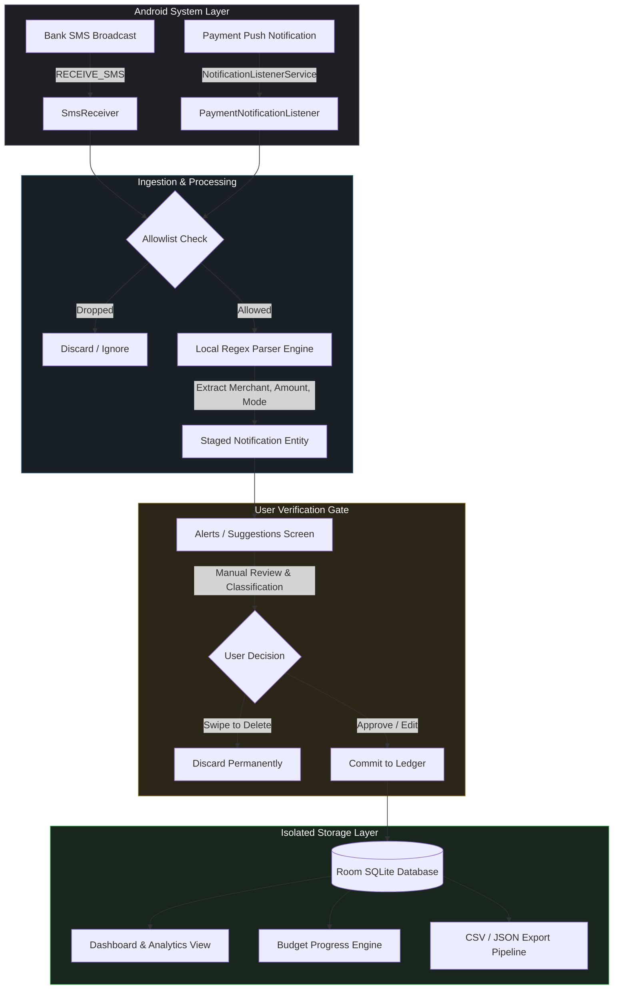
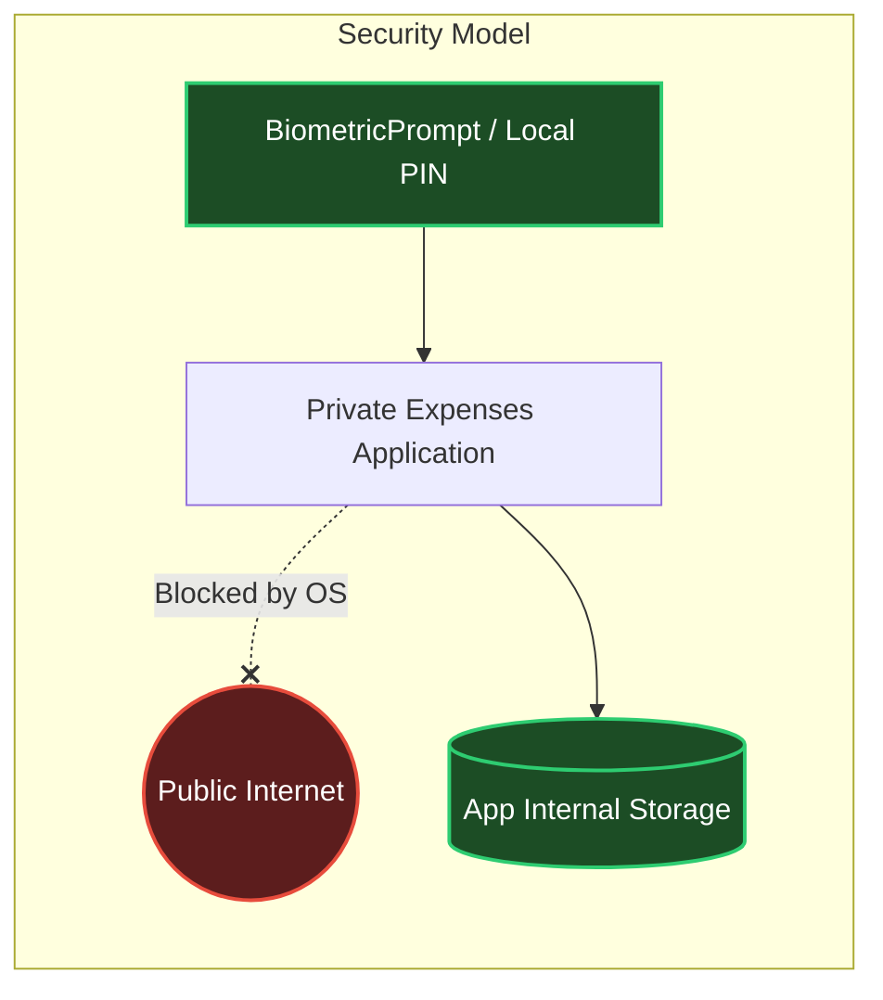
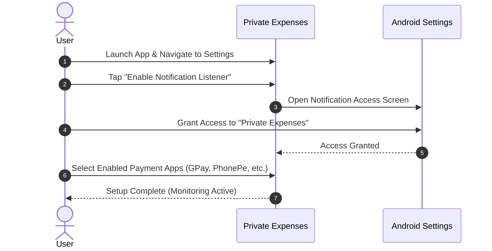

# 🛡️ Private Expenses


> **The zero-permission, air-gapped personal finance tracker for Android.**  
> Automatically captures and parses UPI and banking transactions on-device—with no cloud sync, no tracking, and zero internet permissions.

[-3DDC84?style=flat-square&logo=android&logoColor=white)](https://developer.android.com)
[](https://kotlinlang.org)
[](https://developer.android.com/jetpack/compose)
[](https://developer.android.com/training/data-storage/room)
[-00C853?style=flat-square&logo=shield&logoColor=white)](#-security--privacy-architecture)
[](LICENSE)

---

## 📌 Table of Contents

- [Why Private Expenses?](#-why-private-expenses)
- [How It Compares](#-how-it-compares)
- [System Architecture & Data Flow](#-system-architecture--data-flow)
- [Security & Privacy Architecture](#-security--privacy-architecture)
- [Core Feature Matrix](#-core-feature-matrix)
- [Permission Justification Matrix](#-permission-justification-matrix)
- [Quick Start & Setup Guide](#-quick-start--setup-guide)
- [Technical Architecture](#-technical-architecture)
- [Build & Development Setup](#-build--development-setup)
- [License](#-license)

---

## ⚡ Why Private Expenses?

Most commercial expense trackers follow an invasive model: they ingest your entire SMS inbox, upload banking metadata to cloud providers, and sell aggregated consumer insights.

**Private Expenses re-engineers the paradigm:**

1. **Operating System Enforcement:** The app contains zero network capability. `android.permission.INTERNET` is omitted from the manifest, making external leaks physically impossible.
2. **On-Device Deterministic Parsing:** High-performance regex parses SMS alerts and notification strings locally in milliseconds.
3. **Staging Queue Isolation:** Transactions are never committed to your ledger silently. You approve, classify, or discard each item manually.
4. **Hardware Biometric Lock:** Enforced through Android's `BiometricPrompt` framework backed by secure hardware (TEE/StrongBox).

---

## ⚖️ How It Compares

| Feature / Metric | Standard Tracker Apps | Cloud-Sync FinTech Apps | **Private Expenses** |
| :--- | :---: | :---: | :---: |
| **Internet Access** | Required | Mandatory | ❌ **Completely Blocked (No Permission)** |
| **Data Storage Location** | Remote Cloud (AWS/GCP) | Remote Cloud & Analytics | 🔒 **100% On-Device (Sandboxed SQLite)** |
| **Account / Login Required** | Yes (Email/Phone/OAuth) | Yes (Phone + Banking Auth) | 🛡️ **None (Zero Sign-up)** |
| **SMS Scraping Model** | Full Inbox Sync to Cloud | Full Inbox Sync to Cloud | ⚡ **Push Event Only (On-Device Parsing)** |
| **Transaction Ingestion** | Silent Auto-Import | Silent Auto-Import | 📥 **Staging Queue (Manual Review)** |
| **Tracking / Ads SDKs** | Present (Firebase/Meta/AppsFlyer) | Present (Telemetry/Mixpanel) | 🚫 **Zero External SDKs** |
| **Data Portability** | Subscription / Paywalled | Web Portal Export | 💾 **Direct Local CSV / JSON Backup** |

---

## 🔄 System Architecture & Data Flow



---

## 🔒 Security & Privacy Architecture



### 1. Zero Network Surface
The application omits `android.permission.INTERNET`. The Android Linux kernel terminates any socket creation calls at runtime. Even if a malicious third-party library was injected into the build, it could not transmit telemetry or data out of the device.

### 2. Sandbox File Storage
All database entities exist strictly under `/data/user/0/com.example.privateexpenses/databases/`. Under the Android security model, cross-app access to this directory is denied by default Unix permissions and SELinux policies.

### 3. Non-Intrusive Push-Event Ingestion
Unlike legacy tools that run background jobs polling your entire inbox history, Private Expenses uses reactive event listeners (`BroadcastReceiver` and `NotificationListenerService`). It triggers only when an explicit incoming event matches allowlisted package IDs or sender signatures.

---

## 📊 Core Feature Matrix

| Module | Features Included | Primary User Benefit |
| :--- | :--- | :--- |
| **🏠 Dashboard** | • Monthly spent vs. budget indicator<br>• Daily average burn rate<br>• Category progress bars<br>• Recent transaction feed | Comprehensive financial status in a single glance without navigating deep menus. |
| **⚡ Alerts & Staging** | • Real-time capture queue<br>• Amount / Merchant auto-fill<br>• One-tap approval flow<br>• Built-in payment simulator | Prevents erroneous, duplicate, or irrelevant notifications from contaminating your core ledger. |
| **📜 Ledger History** | • Text search (merchants, notes)<br>• Debit/Credit filters<br>• Time range filters<br>• Multi-parameter sorting | Instant lookups for past spending without index latency. |
| **🎯 Budgets & Caps** | • Global monthly thresholds<br>• Per-category spending caps<br>• 80% & 100% threshold visual alerts | Proactive overspending prevention with dynamic color-coded indicators. |
| **📈 Analytics** | • Net balance cash flow trends<br>• Category distribution ring<br>• Period comparisons (Week/Month/Year) | Visualizes financial health on-device with zero server-side computation. |
| **💾 Export & Portability** | • Standard CSV spreadsheet export<br>• Encrypted JSON database dump<br>• System share sheet integration | Seamless auditing in Excel/Google Sheets and effortless device migrations. |

---

## 📋 Permission Justification Matrix

| Permission | Android ID | Scope & Security Justification |
| :--- | :--- | :--- |
| **Notification Listener** | `BIND_NOTIFICATION_LISTENER_SERVICE` | **Required for Payment Push Parsing.** Listens strictly to notifications originating from package names specified in your allowlist (e.g., Google Pay, PhonePe, Paytm). |
| **Receive SMS** | `android.permission.RECEIVE_SMS` | **Required for Bank Debits.** Listens for incoming transactional SMS debits/credits in real time. Does not parse OTPs or personal texts. |
| **Read SMS** | `android.permission.READ_SMS` | **Optional.** Used solely if you explicitly trigger a one-time import to scan recent bank statements on setup. |
| **Post Notifications** | `android.permission.POST_NOTIFICATIONS` | **Optional.** Delivers a local tray reminder when an expense has been staged and awaits approval. |
| **Biometric Access** | `android.permission.USE_BIOMETRIC` | **Optional.** Authenticates the user locally via system biometric hardware prior to opening the ledger. |
| **Internet Access** | ❌ **NOT REQUESTED** | **Intentionally Excluded.** Guarantees zero outbound data leakage. |

---

## 🚀 Quick Start & Setup Guide

### 1. Initial Permission Configuration


### 2. Ingestion & Approval Workflow
1. **Trigger:** Receive a payment confirmation (via UPI app or bank SMS).
2. **Review:** Open the **Alerts** tab (`💬`).
3. **Approve:** Tap **Quick Save** to accept parsed values, or tap **Edit** to modify categories or add personal notes.
4. **Discard:** Swipe away notifications that should not be logged.

---

## 🏗️ Technical Architecture

### Architectural Overview
The codebase strictly follows standard Android Clean Architecture and MVVM design patterns:

```
app/src/main/java/com/example/
├── data/
│   ├── local/
│   │   ├── ExpenseDatabase.kt         # Room database with versioned migrations
│   │   ├── dao/
│   │   │   └── ExpenseDao.kt          # Reactive Flow/Coroutine SQL queries
│   │   └── entities/
│   │       ├── Expense.kt             # Ledger records
│   │       ├── Budget.kt              # Monthly budget allocations
│   │       └── NotificationItem.kt    # Staging queue items
├── presentation/
│   ├── viewmodel/
│   │   └── ExpenseViewModel.kt        # StateFlow-based unidirectional UI state
│   └── screens/
│       ├── DashboardScreen.kt         # Monthly summary & overview
│       ├── TransactionsScreen.kt      # Searchable, filterable history
│       ├── SuggestionsScreen.kt       # Staging approval inbox & Simulator
│       ├── BudgetsScreen.kt           # Threshold configuration
│       ├── InsightsScreen.kt          # Analytics & CSV export
│       └── SettingsScreen.kt          # App allowlist, PIN & theming
├── service/
│   ├── PaymentNotificationListener.kt # Intercepts allowlisted app push receipts
│   ├── SmsReceiver.kt                 # BroadcastReceiver for bank debits
│   └── ParserEngine.kt                # Thread-safe Regex parsing logic
└── ui/theme/                          # Material 3 tokens, dynamic color, typography
```

---

## 💻 Build & Development Setup

### Environment Requirements
- **JDK:** Version 17 or higher
- **Android Studio:** Ladybug / Meerkat (2024.2+)
- **Android SDK:** Compile SDK 35, Min SDK 26

### CLI Build Commands
```bash
# 1. Clone the repository
git clone https://github.com/your-username/private-expenses.git
cd private-expenses

# 2. Compile and assemble debug APK
./gradlew assembleDebug

# 3. Execute unit tests
./gradlew testDebugUnitTest

# 4. Install debug build to a connected device/emulator
./gradlew installDebug
```

---

## 📄 License

This project is licensed under the **MIT License**. See the [LICENSE](LICENSE) file for terms.
